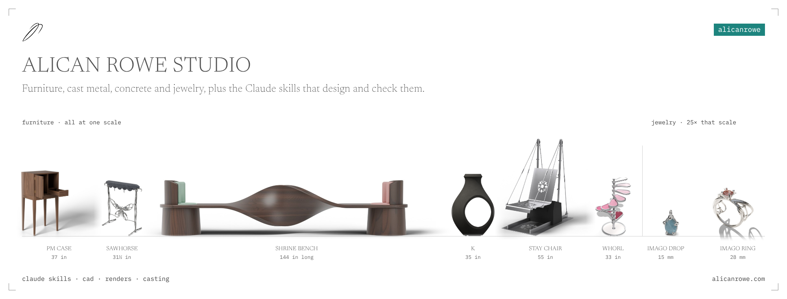

Work lives at [alicanrowe.com](https://www.alicanrowe.com). The repos here are the Claude skills behind it: each one packs the rules, checks and scripts for one craft, so a design can be modelled, checked and rendered before anything is cut, cast or poured.

### Making things

| Skill | What it does |
|---|---|
| [hardwood-furniture-cad](https://github.com/alicanrowe/hardwood-furniture-cad) | Solid-wood furniture in CAD: joinery, wood movement, drawings, cut lists, renders |
| [sculpted-metal-casting](https://github.com/alicanrowe/sculpted-metal-casting) | Cast-metal jewelry and furniture that looks hand-carved and actually casts |
| [concrete-mold-casting](https://github.com/alicanrowe/concrete-mold-casting) | Multi-part molds for concrete and GFRC, checked before printing or pouring |
| [seating-load-check](https://github.com/alicanrowe/seating-load-check) | Pass or fail for anything people sit on, from the CAD model |
| [boots-and-bags](https://github.com/alicanrowe/boots-and-bags) | Leather boots and bags on a real last, flattened into 1:1 patterns |
| [shop-machine-cad](https://github.com/alicanrowe/shop-machine-cad) | Small machines and jigs modelled to their real bought parts |

### Taste, pages and process

| Skill | What it does |
|---|---|
| [design-taste](https://github.com/alicanrowe/design-taste) | Principles, banned moves, a rubric and a verbatim critique log |
| [website-publishing](https://github.com/alicanrowe/website-publishing) | Portfolio pages with renders, a 3D viewer, drawings and specs |
| [deconstruct](https://github.com/alicanrowe/deconstruct) | Take a feature apart, rebuild it, then design something original |
| [human-voice](https://github.com/alicanrowe/human-voice) | Write in someone's own words, nothing invented |
| [eta-estimating](https://github.com/alicanrowe/eta-estimating) | Time estimates from measured baselines |
| [request-handoffs](https://github.com/alicanrowe/request-handoffs) | A request ledger for multi-thread agent projects |
| [offload-to-chatgpt](https://github.com/alicanrowe/offload-to-chatgpt) | Hand bulk work to Codex and videos to Gemini when it's cheaper |

### Life admin

[llc-management](https://github.com/alicanrowe/llc-management) · [school-applications](https://github.com/alicanrowe/school-applications) · [alumni-account-access](https://github.com/alicanrowe/alumni-account-access) · [housing-search](https://github.com/alicanrowe/housing-search)

Each skill installs by copying its folder to `~/.claude/skills/`. MIT licensed.
